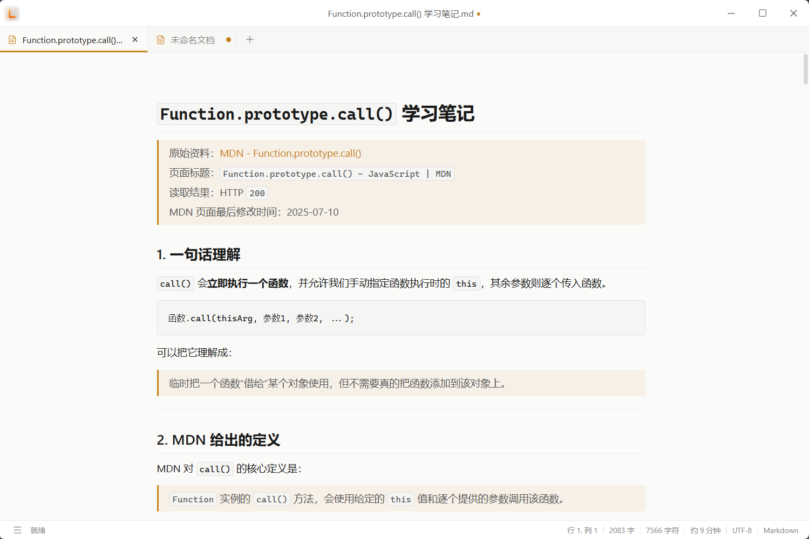
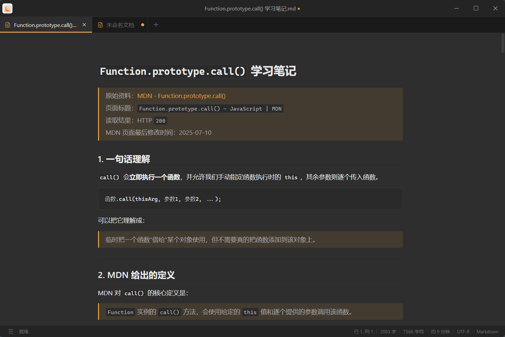
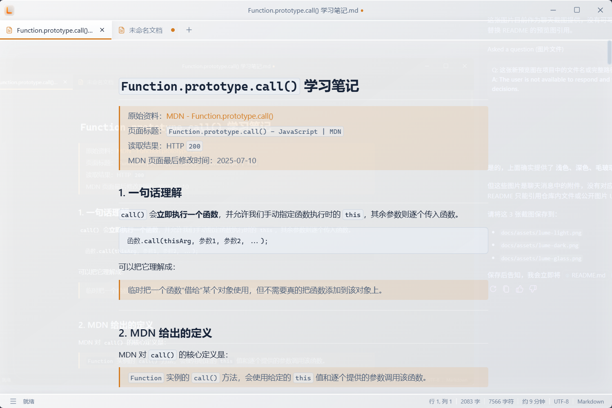

# Lume

[English](README.md) | **简体中文**

**一款安静、轻盈、专注于本地写作的 Markdown 编辑器。**

让文字留在自己的设备里，让写作回归内容本身。

[界面预览](#界面预览) · [体验亮点](#体验亮点) · [Markdown 支持](#markdown-支持) · [图片与资源](#图片与资源) · [项目进度](#项目进度) · [参与项目](#参与项目)

---

## 关于 Lume

Lume 是为个人写作与本地知识整理打造的桌面编辑器。

它直接使用普通的 Markdown 文件，不要求登录账号，不把内容锁进专有格式，也不会改变你原有的文档管理方式。无论是随手记录、学习笔记，还是长期文章，都可以在一个简洁、舒适的空间里完成。

> 你的文字属于你。随时打开，随时迁移，长期可读。

## 界面预览

Lume 提供明亮、沉静与朦胧三种不同氛围，让写作空间适应你的环境与心情。

| 浅色主题                                         | 深色主题                                        | 毛玻璃主题                                         |
| ------------------------------------------------ | ----------------------------------------------- | -------------------------------------------------- |
|  |  |  |

## 体验亮点

| 体验                      | 说明                                                                                 |
| ------------------------- | ------------------------------------------------------------------------------------ |
| ✍️ **专注写作**           | 专注模式隐藏侧栏与标签页，可按偏好调整正文宽度和字号                                 |
| 📄 **本地优先**           | 直接打开和保存本地 Markdown 文件，不依赖账号与在线服务                               |
| ✨ **两种编辑方式**       | 在所见即所得与 Markdown 源码 / 实时预览分栏之间切换，支持分栏滚动同步                |
| 🗂️ **工作区与多文档**     | 打开本地文件夹，通过文件树管理文档；标签页支持拖拽排序与未保存状态提示               |
| 💾 **自动保存与冲突处理** | 已有保存路径的文档自动写回源文件；检测外部修改、重命名和删除，修改冲突时提供处理选择 |
| 🛟 **会话暂存**           | 自动暂存当前标签与编辑内容，关闭应用后再次打开仍可继续写作                           |
| 🔎 **查找与导航**         | 所见即所得模式支持文档内查找、替换与匹配高亮；通过侧栏大纲和文内目录跳转标题         |
| ⌨️ **命令面板**           | 快速执行新建、打开、保存、切换编辑模式和图片处理等常用操作                           |
| 🌗 **舒适外观**           | 提供浅色、深色、跟随系统与毛玻璃外观，适应不同环境与偏好                             |
| 📊 **写作状态**           | 实时显示字数、字符数、阅读时长与光标位置，掌握当前写作进度                           |

## Markdown 支持

| 内容           | 当前支持                                                              |
| -------------- | --------------------------------------------------------------------- |
| **基础排版**   | 标题、段落、粗体、斜体、引用、有序 / 无序列表、分割线与行内代码       |
| **GFM 扩展**   | 表格、任务列表与删除线；所见即所得模式支持表格插入及行列编辑          |
| **链接与脚注** | 行内链接、引用式链接与脚注，支持在正文中编辑                          |
| **代码块**     | 代码语言选择与语法高亮                                                |
| **数学公式**   | 基于 KaTeX 的行内公式与块级公式                                       |
| **图表**       | Mermaid 图表编辑与渲染                                                |
| **文档元数据** | 文档开头的 YAML Front Matter，可在所见即所得模式直接编辑              |
| **文内目录**   | 单独一行输入 `[toc]`，根据文档标题生成可点击目录                      |
| **提示块**     | GitHub 风格的 `NOTE`、`TIP`、`IMPORTANT`、`WARNING`、`CAUTION` 提示块 |

所见即所得模式提供选区工具栏与右键菜单，可执行常用格式操作、块转换和内容插入。源码模式保留直接编辑 Markdown 的方式，预览区同步渲染扩展内容。

## 图片与资源

- **多种插入方式**：本地选图、截图粘贴、拖放、图片 URL 和 Markdown 图片语法；支持行内编辑图片路径。
- **图片编辑**：修改地址、说明和标题，拖动缩放、选择缩放比例、恢复原始大小，以及设置对齐方式。
- **资源整理**：保留原始位置或复制到指定文件夹，支持相对路径、路径转义与文档级图片根目录；可批量复制、移动图片或下载网络图片。
- **可选上传**：配置外部上传程序后，可上传本地图片；支持通过 YAML 元数据为单篇文档指定图片处理规则。

图片插入策略、路径格式与上传器可在「偏好设置 → 图片」中调整。本地写作无需配置上传器。

## 常用快捷键

| 操作                               | Windows / Linux           |
| ---------------------------------- | ------------------------- |
| 新建文档                           | `Ctrl+N` / `Ctrl+T`       |
| 打开文件                           | `Ctrl+O`                  |
| 保存 / 另存为                      | `Ctrl+S` / `Ctrl+Shift+S` |
| 关闭当前文档                       | `Ctrl+W`                  |
| 命令面板                           | `Ctrl+P`                  |
| 偏好设置                           | `Ctrl+,`                  |
| 文档内查找与替换（所见即所得模式） | `Ctrl+F`                  |
| 插入图片                           | `Ctrl+Shift+I`            |

macOS 使用 `Command` 替代上述 `Ctrl`。

## 适合用来做什么

- 记录灵感、日记与日常随笔
- 整理课程、阅读和技术学习笔记
- 撰写博客、文章与长篇内容
- 管理可以长期保存和迁移的 Markdown 文档
- 在不连接云服务的情况下安静写作

## 设计原则

| 原则              | 含义                               |
| ----------------- | ---------------------------------- |
| **本地优先**      | 内容保存在自己的设备中，由自己掌控 |
| **Markdown 优先** | 文件保持开放、可读、可迁移         |
| **写作优先**      | 输入体验与内容表达高于功能堆叠     |
| **简单可靠**      | 用清晰的交互完成常用工作           |
| **渐进增强**      | 在稳定基础体验之上谨慎增加能力     |

## 项目进度

Lume 目前处于早期开发阶段，仓库版本为 **0.5.0**。当前代码已具备本地文档编辑、工作区文件管理、自动保存、外部冲突处理和会话恢复，并持续完善 Markdown 扩展与图片操作体验。

桌面应用基于 Tauri 2、Rust、Vue 3 和 TypeScript，所见即所得编辑使用 Milkdown / ProseMirror，分栏预览使用 markdown-it。工作区文件管理、自动写回源文件和本地图片资源处理等能力依赖桌面环境；浏览器模式用于前端开发与基础体验预览。

接下来将继续完善：

- 源码编辑区的搜索与替换
- 工作区全文搜索、索引与快速打开
- 最近文件与工作区记录
- 通用附件管理与相对路径插入
- 大文档性能与跨编辑模式的交互一致性
- HTML 与 PDF 导出

详细计划请查看 [产品与开发路线图](docs/roadmap.zh-CN.md)。

## 参与项目

欢迎提交问题、分享使用感受或参与改进。无论是一个交互建议、一处文案修正，还是一个新的使用场景，都能帮助 Lume 变得更好。

- 开始参与前，请阅读 [开发说明](docs/development.zh-CN.md)
- 想了解后续方向，请查看 [产品与开发路线图](docs/roadmap.zh-CN.md)
- 发现问题时，请尽量附上复现步骤、系统环境与相关截图

## 当前说明

> Lume 尚未发布稳定版本，界面、功能和文档仍可能调整。重要文档请保留独立备份。

## 许可证

本项目采用 [PolyForm Noncommercial License 1.0.0](LICENSE.md)。

- 允许个人学习、研究、实验、业余项目及其他非商业用途
- 允许在非商业目的下修改和分发，但必须保留许可证及相关声明
- **禁止将本项目或其衍生作品用于商业用途**
- 商业授权需求请联系项目作者另行取得许可

> 由于许可证限制商业用途，本项目属于源码可见项目，不属于 OSI 定义的开源软件。

---

**Lume · 为文字留一束安静的光。**
