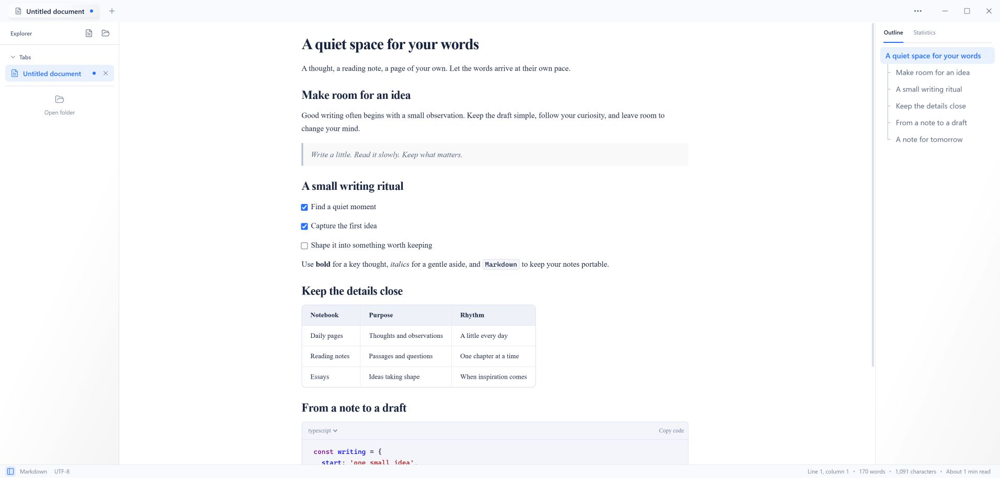
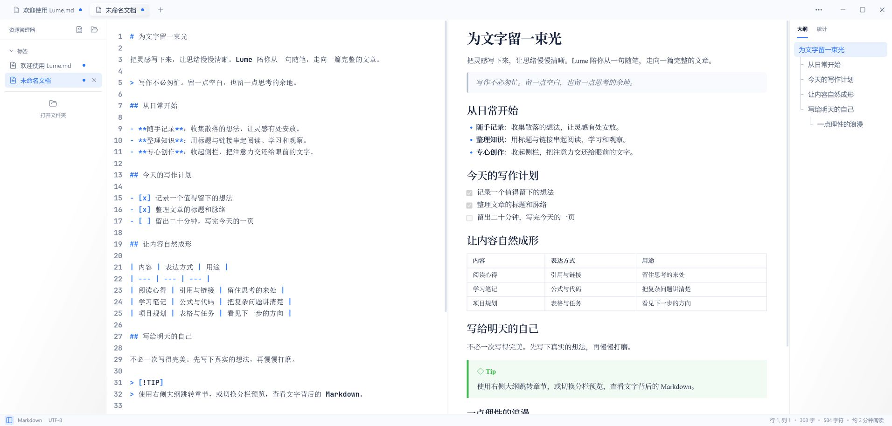
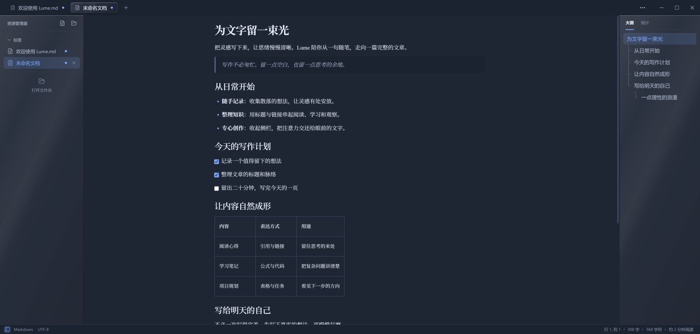
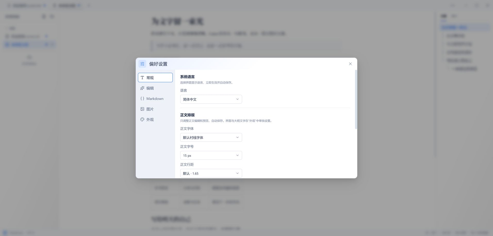

  

<h1 align="center">Lume</h1>

<strong>为文字留一束安静的光。</strong>

一款面向个人创作、日常笔记与本地知识整理的桌面 Markdown 编辑器。

<a href="README.md">English</a> · <strong>简体中文</strong>

  <a href="https://github.com/sh3yee/lume/releases">下载使用</a> ·
  <a href="#界面预览">界面预览</a> ·
  <a href="#功能亮点">功能亮点</a> ·
  <a href="#开始使用">开始使用</a> ·
  <a href="docs/markdown-guide.zh-CN.md">操作指南</a> ·
  <a href="https://github.com/sh3yee/lume/issues">反馈建议</a>

Lume 直接读写设备上的普通 Markdown 文件，写作无需注册账号，文档可以随时打开、迁移和长期保存。从一句灵感、一份阅读笔记，到一篇反复打磨的长文，都可以按自己的节奏慢慢完成。

## 界面预览

**直接在页面上写作。** 左侧切换文档，右侧查看大纲，把中间的空间留给文字。

**让源码与结果并排呈现。** 分栏模式提供源码高亮、行号、实时预览与同步滚动。

查看深色主题与偏好设置

浅色、深色或跟随系统，两种主题下的通透侧栏都围绕正文展开。深色主题采用柔和的蓝灰玻璃底色，文件栏与大纲在顶部自然衔接标题栏。

语言、正文排版、编辑布局、Markdown 扩展和图片处理都可以在偏好设置中调整。

以上截图来自当前浏览器预览，使用英文界面与英文演示文档展示排版。

## 功能亮点

### 按习惯写作

- **所见即所得**：直接编辑排版后的正文，通过 Markdown 输入、选区工具栏或右键菜单完成格式调整和内容插入。
- **源码与实时预览**：需要处理 Markdown 语法时，切换到分栏模式，一边修改，一边查看结果。
- **专注模式**：隐藏文件栏、大纲和文档标签，把更多空间留给当前文章。
- **舒适排版**：调整正文字体、字号、行距与页面宽度；界面字体和大纲字号可以单独设置。
- **适合自己的外观**：支持浅色、深色、跟随系统，以及简体中文和英文界面；文档标签栏与状态栏可独立隐藏。
- **自定义应用快捷键**：在「偏好设置 → 快捷键」中搜索、修改、清除或恢复文件与视图等操作的快捷键，立即生效并保存到本地。
- **关于与在线更新**：在「偏好设置 → 关于」查看版本和作者、检查更新，在应用内下载更新包并安装重启。发布前需完成[更新签名配置](docs/online-updates.zh-CN.md)。

### 让文档留在自己手中

- **文件夹就是工作区**：浏览本地文件树，在应用内新建、重命名、移动和删除文件或文件夹。
- **多文档切换**：通过顶部标签或左侧文档列表切换内容，拖拽调整标签顺序，随时查看未保存状态。
- **自动保存**：桌面应用会将已有保存位置的文档自动写回原文件；新草稿首次保存后即可使用。
- **会话恢复**：在本地暂存已打开的文档与草稿内容，再次打开应用时继续写作。
- **外部变化处理**：检测当前工作区中的文件变化，遇到编辑冲突或文件被删除时，由你选择如何处理。

### 长文章也能从容阅读

- **大纲导航**：通过右侧大纲跳转标题；左右侧栏均可拖动调整宽度。
- **文档内查找**：所见即所得模式支持查找、替换与匹配高亮。
- **命令面板**：用键盘快速新建、打开、保存文档，切换视图、启用专注模式或处理图片。
- **写作统计**：在统计面板查看字数、字符数、行数与预计阅读时长，状态栏同时显示光标位置。

### 分享写作成果

将当前文档（含未保存的修改）导出为带样式 HTML、无样式 HTML 或 PNG 图片。PDF 导出会打开系统打印窗口，选择「另存为 PDF」即可保存。可从命令面板或标题栏右键菜单打开「导出…」，也可按 `Ctrl+Alt+E`。格式差异与资源限制见[操作指南](docs/markdown-guide.zh-CN.md#导出文档)。

## Markdown 支持

各类语法的输入方法、鼠标与键盘操作、模式差异，请参阅 [Markdown 语法与操作指南](docs/markdown-guide.zh-CN.md)。

| 内容           | 可以做什么                                                                          |
| -------------- | ----------------------------------------------------------------------------------- |
| 日常排版       | 标题、粗体、斜体、删除线、行内代码、引用、嵌套列表与分割线                          |
| 表格与任务     | 插入表格、增删行列、设置列对齐，在所见即所得模式中勾选任务                          |
| 链接与引用     | 编辑行内链接和引用式链接，跳转标题锚点，使用脚注                                    |
| 代码块         | 选择代码语言、语法高亮编辑，一键复制代码                                            |
| 数学公式       | 编写 LaTeX 行内公式和块级公式，并查看渲染结果                                       |
| Mermaid 图表   | 在所见即所得模式中编辑 `mermaid` 代码块，在分栏预览中查看图表                       |
| 文档结构       | 编辑 YAML Front Matter；单独一行输入 `[toc]`，生成可点击的标题目录                  |
| 提示块         | GitHub 风格的 `NOTE`、`TIP`、`IMPORTANT`、`WARNING`、`CAUTION`                      |
| 扩展行内格式   | 在设置中启用 `==高亮==`、`H~2~O` 下标与 `X^2^` 上标                                 |
| 表情与自动链接 | 使用表情短代码与补全，将直接输入的网址识别为链接                                    |
| HTML 与媒体    | 支持范围内的行内 HTML、HTML 块、SVG、音频、视频与 iframe 嵌入，可就地编辑 HTML 源码 |

可在「**偏好设置 → Markdown**」中按需开启扩展。高亮、下标和上标默认关闭。媒体播放和远程嵌入的可用性取决于系统 WebView 与来源网站。

## 图片与资源

让配图自然融入写作流程：

- 从本地插入图片、粘贴截图、拖放图片文件，或直接使用图片网址。
- 修改图片地址、替代文字与标题；拖动缩放或选择预设比例，恢复原始大小，调整对齐方式。
- 保留图片原位置，或复制到指定资源文件夹；支持相对路径与单篇文档的图片根目录。
- 批量复制、移动文档中的图片，或将网络图片下载到本地。
- 按需配置外部上传程序；通过 YAML 元数据为单篇文档指定图片处理规则。

相关规则可在「**偏好设置 → 图片**」中调整。上传器是可选项，本地写作与本地图片无需配置上传服务。使用网络图片、远程嵌入或上传器时会访问相应网络服务。

## 开始使用

1. 前往 [Releases 下载页面](https://github.com/sh3yee/lume/releases)，选择适合系统的安装包。Lume 面向 Windows、macOS（Apple Silicon / Intel）和 Linux，具体可用文件以各版本页面为准。
2. 打开已有的 `.md` 或 `.markdown` 文件，新建一篇文档，或选择本地文件夹作为工作区。
3. 在默认的所见即所得模式中开始写作。需要查看源码时，通过「偏好设置 → 编辑」或命令面板切换到分栏预览。
4. 首次保存新文档，选择文件位置；之后的修改会由桌面应用自动保存。
5. 使用大纲跳转章节，再按习惯调整字体、排版与主题，找到舒适的写作状态。

Lume 以桌面应用为主要使用方式。浏览器预览提供基础编辑与下载保存；工作区管理、自动写回原文件和本地资源处理需要桌面环境。

## 常用快捷键

| 操作                           | Windows / Linux           |
| ------------------------------ | ------------------------- |
| 新建文档                       | `Ctrl+T`                  |
| 打开文件                       | `Ctrl+O`                  |
| 保存 / 另存为                  | `Ctrl+S` / `Ctrl+Shift+S` |
| 导出                           | `Ctrl+Alt+E`              |
| 关闭当前文档                   | `Ctrl+W`                  |
| 命令面板                       | `Ctrl+P`                  |
| 偏好设置                       | `Ctrl+,`                  |
| 显示 / 隐藏文件栏              | `Ctrl+Shift+E`            |
| 显示 / 隐藏大纲与统计          | `Ctrl+Shift+O`            |
| 文档内查找与替换（所见即所得） | `Ctrl+F`                  |
| 插入图片                       | `Ctrl+Shift+I`            |

以上为默认绑定，macOS 使用 `Command` 替代 `Ctrl`。应用快捷键可在「偏好设置 → 快捷键」修改，编辑器格式快捷键保持固定。专注模式和编辑模式切换均可从命令面板执行，也可自行绑定快捷键。

## 项目状态与反馈

Lume 目前处于早期开发阶段，仓库版本为 **0.8.5**，界面与编辑体验仍在持续调整。重要文档请保留独立备份，会话恢复只用于方便继续写作。

工作区全文搜索、最近文件记录和源码编辑区的查找替换尚未提供。后续主要集中在 WebDAV、Git、自托管存储，以及百度网盘、阿里云盘等可选同步方向；这些接入目前尚未提供，详见 [产品路线图](docs/roadmap.zh-CN.md)。

遇到问题或有新的想法，欢迎 [提交 Issue](https://github.com/sh3yee/lume/issues)。反馈时请尽量附上复现步骤、操作系统和必要截图，并移除示例中的私人内容。也欢迎参与改进，环境配置与开发细节请参阅 [开发说明](docs/development.zh-CN.md)。

## 许可证

Lume 采用 [PolyForm Noncommercial License 1.0.0](LICENSE.md)，允许在许可证条款下进行非商业使用、修改和分发。商业使用需要联系作者另行获得授权。

本项目属于采用非商业许可证的源码可见项目。

---

**Lume · 为文字留一束安静的光。**
