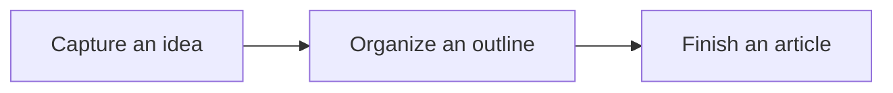

# Lume Markdown Syntax and Editing Guide

**English** | [简体中文](markdown-guide.zh-CN.md)

This guide describes **the Markdown syntax, editing interactions, and commands currently implemented in Lume**.

Applies to repository version **0.8.0** and the current repository implementation. Reviewed on October 26, 2026.

[Editing modes and common operations](#editing-modes-and-common-operations) · [Block elements](#block-elements) · [Inline elements](#inline-elements) · [HTML and embedded content](#html-and-embedded-content) · [Files and export](#files-and-export) · [Keyboard shortcuts](#keyboard-shortcuts) · [Current limitations](#current-limitations)

## Editing modes and common operations

### Choose an editing mode

| Mode          | How it works                                                                                                                               | Useful for                                                               |
| ------------- | ------------------------------------------------------------------------------------------------------------------------------------------ | ------------------------------------------------------------------------ |
| WYSIWYG       | Edit formatted content directly. Typed syntax can turn into formatted content; use the selection toolbar and context menus for adjustments | Everyday writing, tables, tasks, images, and math                        |
| Split preview | Edit Markdown source on the left and read the rendered result on the right, with synchronized scrolling                                    | Inspecting syntax, changing source in bulk, and viewing Mermaid diagrams |

Choose a mode under **Preferences → Editor**, or press `Ctrl+P` to open the command palette and run **Toggle editing mode**.

Unless stated otherwise, instructions such as clicking to edit, using a floating toolbar, or converting a block through its context menu refer to **WYSIWYG mode**. In split view, make changes in the left source pane. The right preview does not modify the document directly; you can select and copy text or follow supported links and table of contents entries.

Code examples show the Markdown saved in a file. To insert a complete example, paste it into the source pane, then switch back to WYSIWYG. Pasting directly into WYSIWYG also recognizes clear Markdown structures. Use `Ctrl+Shift+V` when you want to paste literal text.

This guide uses `Ctrl` for Windows / Linux shortcuts. On macOS, generally substitute `Command`. `Enter` means the Return key.

### Select text or an object

| Target        | How to select it                                         | Available operations                                                                                                   |
| ------------- | -------------------------------------------------------- | ---------------------------------------------------------------------------------------------------------------------- |
| Ordinary text | Drag over text or extend the selection with the keyboard | Bold, italic, strikethrough, inline code, links, and copy; the context menu provides more actions                      |
| Image         | Click the image                                          | Alignment, description editing, scaling, and size reset                                                                |
| Table         | Place the cursor in a cell or select multiple cells      | Row and column operations, column alignment, and table deletion; selecting text inside a cell provides text formatting |
| Inline math   | Click to expand its Markdown source                      | Edit `$...$` in place; the context menu also offers formula properties, source copying, and deletion                   |
| Math block    | Click the formula block                                  | Expand its source editor and live preview in place                                                                     |
| Code          | Select text inside the code block                        | Copy or cut the selected code and paste plain text; whole-block copying and language settings have separate controls   |
| HTML          | Use its in-place source control or context menu          | Edit HTML source and copy node Markdown; HTML objects do not display an additional “Source node” floating toolbar      |
| Mixed content | Select text together with other blocks or objects        | Primarily copy and cut; text formatting is not applied indiscriminately                                                |

Clicking ordinary text only places the cursor. Its formatting toolbar requires a text selection. Tables and objects have their own activation rules.

Right-clicking inside an existing selection keeps that selection. Right-clicking outside it targets the new position or object. Disabled menu items cannot be applied to the current structure.

**Convert current block** changes a paragraph or container type. **Insert after current block** adds content and generally keeps the existing text. YAML front matter is an exception: it is always inserted at the document start.

Changes made in an in-place source editor generally become part of the document as you type. Finishing, collapsing, or pressing `Escape` does not consistently mean canceling changes. Use Undo to reverse edits; property dialogs also provide a Cancel button.

### Edit inline Markdown in place

Bold, italic, strikethrough, inline code, and enabled highlight / subscript / superscript formats share an in-place source editor. After you finish typing paired markers, the source stays visible while the cursor is inside it. Move the cursor out to render the formatted result.

- Click formatted text or move into it with the arrow keys to expose its Markdown markers and edit the text or delimiters.
- Click an inline formula or footnote reference to expose `$...$` or `[^label]` in the same way. Images and links have separate source-editing controls.
- `Escape` leaves the source; Left / Right at its boundaries returns to surrounding text. `Enter` or `Tab` leaves source editing and continues the editor's normal key behavior, so `Enter` can also split the paragraph.
- Moving focus away renders complete syntax. Incomplete syntax stays visible and is saved literally. `Escape` does not discard edits.

Text selection still provides formatting actions; simply clicking formatted text opens its source rather than its selection toolbar.

### Enable optional extensions

Open **Preferences → Markdown**.

| Setting               | Default | Purpose                                                           |
| --------------------- | ------- | ----------------------------------------------------------------- |
| Highlight             | Off     | Render `==important==` as highlighted text                        |
| Subscript             | Off     | Render `H~2~O` with a subscript                                   |
| Superscript           | Off     | Render `X^2^` with a superscript                                  |
| Inline math           | On      | Render `$...$` inline formulas; this does not control math blocks |
| Mermaid diagrams      | On      | Render `mermaid` code blocks in split preview                     |
| Automatic links       | On      | Recognize plain URLs and similar addresses as links               |
| Emoji                 | On      | Display emoji shortcodes and offer completion                     |
| GitHub callout styles | On      | Apply styles to the five supported callout types                  |

Emoji completion is manual by default and can be changed to automatic. Preferences are saved locally. Disabling a format's display can retain its markers or source; you do not need to delete content just to view it as source.

## Block elements

### Paragraphs and line breaks

In ordinary text, press `Enter` to start a paragraph or `Shift+Enter` to insert a line break within the paragraph.

```markdown
This is the first paragraph.

This is the second paragraph.
```

In source, separate paragraphs with a blank line. A single source newline does not necessarily produce a visible hard break. For an explicit break, leave two spaces at the end of the line before starting the next, or use a supported `<br>` tag.

Lists, tables, code, math, and HTML source editors have their own Enter behavior. Paragraph rules do not apply to every content type.

### Headings

```markdown
# A reading session

## Notes and reflections

### Questions to explore

###### A level-six heading
```

- At the start of a paragraph, type one to six `#` characters followed by a space. The source remains visible with blue `#` markers. Enter the heading text, then press `Enter` at the end of the line to render the heading and continue in a new paragraph.
- Right-click and choose **Convert current block → Convert to heading N** to change a paragraph or heading level.
- Use `Ctrl+Alt+1` through `Ctrl+Alt+6` for the corresponding level.
- Use `Ctrl+Alt+0` or **Convert to paragraph / Exit container** to return to ordinary text. Inside a list or quote, this first handles the surrounding container.
- Click a heading in the right outline or document table of contents to navigate. Toggle the outline with `Ctrl+Shift+O`.

### Blockquotes

```markdown
> Keep a thought worth remembering.
>
> A quote can contain several paragraphs.
>
> > This is a nested quote.
```

- Type `>` followed by a space at the start of a paragraph.
- For existing paragraphs, use **Convert selection to blockquote** in the context menu, or press `Ctrl+Shift+B`.
- Quotes can contain ordinary text, inline formatting, lists, and other content.
- To leave a quote, place the cursor in the relevant paragraph and use **Convert to paragraph / Exit container**. Nested containers can be exited one level at a time.

### Bullet and ordered lists

```markdown
- Read a chapter
- Save a passage
  - Add your own interpretation

1. Gather material
2. Organize the structure
3. Finish a draft
```

- Start a paragraph with `- `, `* `, or `+ ` for a bullet list, or a number such as `1. ` for an ordered list.
- Press `Enter` in a nonempty item to split it and continue with the next item. Pressing `Enter` in an empty item can exit the current level.
- `Tab` indents an item; `Shift+Tab` outdents it or exits the list. Indenting requires a suitable preceding item; otherwise the structure stays unchanged.
- The context menu also provides **Indent selected items** and **Outdent selected items / Exit list**.
- `Ctrl+Alt+7` converts to an ordered list; `Ctrl+Alt+8` converts to a bullet list. When the cursor is already in a list, switching the type affects that entire list.

### Task lists

```markdown
- [ ] Finish this chapter
- [x] Organize the reading outline
```

1. Type `- ` to start a bullet list.
2. At the start of the item, type `[ ] ` for an incomplete task or `[x] ` for a completed task. The trailing space confirms the input.
3. Click the checkbox to change its state, or choose **Toggle task status** in the context menu.
4. Press `Enter` in a nonempty task item to create a new incomplete task. It does not inherit the previous task's checked state.

Tasks can be nested and support ordinary inline formatting. Checkboxes in split preview are read-only. Change `[ ]` / `[x]` in the source pane or switch back to WYSIWYG to toggle them.

### Fenced code blocks

````markdown
```javascript
const message = 'Write a little today'
console.log(message)
```
````

**Create a block:**

- Right-click **Insert after current block → Code block**, or press `Ctrl+Alt+C` to insert a code block after the current block.
- In an empty paragraph, type three backticks, optionally followed by a language tag such as `javascript`, then press `Enter` to create the code block. Typing a space alone does not confirm the fence.
- Enter or paste complete fenced blocks in the source pane.

**Edit and exit:**

- Click the code area to edit. `Enter` inserts a newline; `Tab` indents.
- Click the language name at the top left to search and select a language. **Set code language** in the context menu lets you enter a language tag directly.
- Click **Copy code** or choose **Copy entire code block** to copy the code body without Markdown fences.
- Select part of the code to copy or cut it. Pasting inserts plain text rather than rich content such as tables.
- Press `Ctrl+Enter` to exit to the paragraph after the code block. The context menu can also insert a paragraph before or after it.
- Pressing `Enter` on an empty final line also continues in a paragraph after the block. `Backspace` in an entirely empty code block converts it to a paragraph.
- Use the arrow keys at code boundaries to move to adjacent text.

The code editor provides language support for JavaScript, TypeScript, HTML, CSS, JSON, Markdown, Python, Rust, Java, C/C++, Go, and SQL. Other languages can still be kept as code text; highlighting may differ.

### Math blocks

```markdown
$$
E = mc^2
$$
```

1. In an empty paragraph, type `$$` and press `Enter` to create a math block.
2. Enter LaTeX source. A live formula preview appears below it.
3. Ordinary `Enter` adds a source line. Click the completion button or press `Ctrl+Enter` to finish and move to the following text.
4. Click the formula block again to edit it in place.

Press Up on the first source line to return to preceding text, or Down on the last line to move after the block. When the source is empty, `Backspace` or `Delete` removes the math block and restores an editable paragraph at its position.

The context menu can copy the formula source or delete the formula. Math blocks use KaTeX for display; they do not perform calculations. Supported LaTeX commands depend on the renderer. The Inline math preference does not control block formulas.

### Tables

```markdown
| Topic   |   Status    |              Notes |
| :------ | :---------: | -----------------: |
| Reading | In progress |      Chapter three |
| Writing | Not started | Allow half an hour |
```

**Create a table:**

- In a separate paragraph, type `| Topic | Status |`, place the cursor at the end, and press `Enter`. Lume creates a table with the corresponding number of columns and moves into its first body row.
- Alternatively, right-click **Insert after current block → Table** to insert a three-column table with a header and two body rows.
- In source mode, use the complete header, separator, and data-row syntax.

**Edit and navigate:**

- Click a cell to enter text. Cells support inline content such as bold, italic, and links.
- `Tab` moves to the next cell; `Shift+Tab` moves to the previous one.
- `Enter` or `Ctrl+Enter` inserts a paragraph after the table and exits it. It does not add a data row.
- Placing the cursor in a cell makes the table toolbar available. For more actions, right-click **Current table / Selected rows and columns**.
- The menu supports inserting rows above or below, inserting columns to either side, deleting selected rows or columns, and aligning whole columns left, center, or right.
- Dragging across cells creates a cell selection. Selecting text within a cell creates a text selection. Column alignment affects the entire columns covered by the selection.

A header and at least one body row must remain, so some row-deletion actions are disabled. Choose **Delete entire table** to remove the table. If the entire table contains no text or inline objects, `Backspace` can also remove it.

### Footnotes

```markdown
A thought deserves an additional explanation[^reading].

[^reading]: Add supporting material here, including **bold text** and links.
```

- Type `[^identifier]` in the text and `[^identifier]: ` in a separate paragraph, followed by the definition. Matching identifiers connect the reference and definition.
- A reference without a matching definition may initially remain plain text. Adding the definition allows it to be recognized as a footnote.
- Hover over a reference to see a text tooltip containing its definition.
- Click a reference to expand `[^identifier]` in place and edit the identifier. Move focus away or press `Escape` to finish; `Enter` leaves the source and follows the paragraph's normal behavior. `Escape` does not undo changes.
- `Ctrl+click` a reference to jump to its definition, or choose **Go to / Edit footnote definition** in the context menu.
- Click `↩` in the definition to return to its reference.

Changing a reference identifier does not automatically create a matching definition. An unresolved identifier may return to literal source text; add or update the definition as well. Split preview displays footnotes and supports navigation between references and definitions.

### Horizontal rules

```markdown
The first part.

---

The next part.
```

- In a separate paragraph, type `***`, `---`, or `___` and press `Enter` at the end. The paragraph becomes a divider, with a following paragraph ready for writing.
- **In the first paragraph of a document, `---` creates YAML front matter instead.** To insert a divider at the document start, use `***` or **Insert after current block → Divider**.
- Click a divider to select it. Its context menu can insert paragraphs before or after it, or delete it.
- With a divider selected, arrow keys move toward adjacent content; `Enter` continues in the text after it.

### YAML front matter

```markdown
---
title: Reading notes
tags: [reading, writing]
---

Start the article here.
```

1. Type `---` in the first paragraph and press `Enter` to enter the metadata editor.
2. Enter YAML directly. Ordinary `Enter` adds a line within the metadata.
3. Type `---` on a separate final line and press `Enter`, or press `Ctrl+Enter`, to return to the following text.

You can also choose **Insert after current block → YAML front matter**. Metadata is always placed at the document start, regardless of the cursor position. A second front matter block cannot be inserted when one already exists.

Metadata is edited as source and can retain comments, multiline values, and custom fields. A file without a closing metadata delimiter should not be expected to form a complete YAML block.

Lume uses some document-level image fields, including `typora-root-url` and `typora-copy-images-to`, which can be set through image commands. Copying or uploading also depends on the corresponding permission options under **Preferences → Images**. Other custom fields are stored as metadata without automatically enabling additional behavior.

### Table of contents (TOC)

```markdown
[toc]

# Reading notes

## Chapter one

## Chapter two
```

- In a standalone top-level paragraph, type `[toc]` or `[TOC]` and press `Enter`, or choose **Insert after current block → Table of contents**.
- The table of contents gathers level-one through level-six headings and updates when headings change.
- Click an entry to navigate to its heading. Duplicate heading text still refers to separate positions.
- With the table of contents object selected, press `Enter` to continue writing after it.
- Saving keeps the `[toc]` marker rather than writing the generated heading list into the file.

A `[toc]` inside inline code or an escaped `\[toc]` does not create a table of contents. The document table of contents is stored in the article; the right outline is an app navigation panel. Both can be used together.

### Diagrams: Mermaid

````markdown

````

- Create a code block, set its language to `mermaid`, and enter the diagram source.
- **WYSIWYG displays an editable code block.** Language selection, copying, and exit behavior follow the code-block rules.
- Switch to split preview to render the diagram on the right. Mermaid supports diagram types such as flowcharts and sequence diagrams.
- Turn off **Preferences → Markdown → Mermaid diagrams** to display code in the preview instead.
- Invalid syntax retains the code and reports a rendering failure. Correct the left-hand source and check the preview again.

Lume does not currently provide dedicated rendering for standalone `sequence` or `flow` / `flowchart` fences. Use the corresponding syntax inside a `mermaid` fence instead.

## Inline elements

### Links

```markdown
[Reading material](https://example.com/notes 'Open the reading material')
```

**Create and edit:**

- Type a complete `[text](address)`, with an optional title.
- Select text, then use the toolbar's link button or right-click **Link selected text** to enter the address and title.
- Click an ordinary link, or move the cursor into its text, to expand its Markdown in place. Edit the text, address, and title directly.
- Moving the cursor out collapses it back to a link. `Escape`, `Tab`, or Left / Right at a source boundary moves out of the link. `Enter` ends link editing and continues the paragraph's normal splitting behavior.
- Incomplete link syntax remains as source. Clearing the expanded content deletes that link content.

**Open and remove:**

- In WYSIWYG, use `Ctrl+click` or **Open link** in the context menu. An ordinary click is primarily for editing.
- The context menu also provides **Copy link address**, **Edit link address**, and **Remove link**. Removing a link keeps its text.
- In split preview, click a supported link directly to open it. An existing text selection takes priority over navigation.

Web links support HTTP(S). Local `.md`, `.markdown`, and `.txt` links require the desktop app. Relative paths are based on the current saved document's folder; save an untitled document first.

#### Internal links

```markdown
[Jump to the reading plan](#reading-plan)

## Reading plan
```

Use `Ctrl+click` in WYSIWYG to jump to a heading with a matching anchor. The document table of contents and right outline also provide navigation.

The two modes do not yet use the same heading anchor rules. Split preview generates internal numeric identifiers, so a handwritten fragment such as `#reading-plan` may not find its target there. Prefer the generated table of contents or right outline for navigation across modes.

A fragment in a local file link, such as `other.md#section`, currently opens the file without automatically navigating to the heading in that other file.

#### Reference links

```markdown
Read [an article][article], or visit the [library][].

[article]: https://example.com/article 'Article title'
[library]: https://example.com/library
```

- A reference and its definition share an identifier in square brackets. Definitions can appear elsewhere in the document.
- Edit the reference in the body and the address at its definition. Changes to the definition update the corresponding links.
- Press `Enter` on a definition line to move into an ordinary paragraph after it.
- Reference links and their definitions can be saved. Using **Edit link address** on an existing reference link updates its definition, including other links using the same identifier.

### URLs and email addresses

```markdown
<https://example.com>
<reader@example.com>

https://example.com/notes
```

Angle brackets create explicit links. With **Automatic links** enabled, plain URLs and email addresses in ordinary text can also be recognized. Edit an automatically detected URL's visible text directly; it does not use the same expanded source editor as a regular explicit link.

**Link recognition and opening are separate capabilities.** Lume's opening action currently focuses on HTTP(S), current-document anchors, and the local text files listed above. An email address can appear as a link without an action to launch a mail app. You can copy the address when needed.

### Images

```markdown

```

**Insert:**

- Press `Ctrl+Shift+I` or run **Insert image** from the command palette to create an image placeholder and enter its path in place.
- Use **Insert local images…** to choose files, paste screenshots, drop image files, or use an image URL.
- After typing complete image syntax in WYSIWYG, press Space or `Enter` to convert it to an image. `Enter` also provides a following paragraph.
- The image source editor lets you edit the complete `` as one text range. Confirm with `Enter` / `Tab`; `Escape` leaves editing without undoing changes. The local file selection button appears for an empty path.

**Adjust:**

- Click an image to select it and reveal its toolbar and resize handle.
- Double-click an existing image to open its Markdown source in place. Edit its address, alt text, or title while retaining the image preview. If you break the image syntax, it becomes ordinary editable text.
- Drag the handle to resize, or choose a percentage under **Scale image** in the context menu.
- The toolbar and context menu support left, center, and right alignment and **Reset image size**.
- **Replace image / Edit description** changes the address, alt text, and title. The context menu can also copy the image address or image Markdown.
- With an image selected, `Backspace` / `Delete` or **Remove image reference** removes only its reference from the document.

**Organize files:**

The context menu provides **Move / Rename image…**, **Copy image to…**, and **Upload image**. The command palette also provides batch operations. Under **Preferences → Images**, choose whether to keep original locations, copy to an asset folder, use relative paths, or configure an external uploader.

**Delete image and source file…** differs from removing a reference: it also affects the image file on disk, so check the target. Relative paths and local asset operations depend on the desktop app and the saved document's location. Extra sizing and alignment information may be saved as HTML image markup; other Markdown viewers need corresponding HTML support to reproduce it.

### Emphasis (italic)

<!-- prettier-ignore -->
```markdown
*Text to emphasize*
_Another italic form_
```

Complete the paired markers, then move the cursor out to render italic text. Click it again to edit the source in place. For existing text, use the selection toolbar, **Italic** in the context menu, or `Ctrl+I`. Do not place spaces immediately inside the opening or closing markers. Stars and underscores inside code remain code text.

### Bold

<!-- prettier-ignore -->
```markdown
**The most important sentence**
__Another bold form__
```

Use paired double asterisks or underscores. You can also select text and use the toolbar, **Bold** in the context menu, or `Ctrl+B`. Apply the action again to remove the format.

### Inline code

```markdown
Use `writeNote()` to record a thought.
```

Wrap text in backticks, or select text and choose **Inline code** / `Ctrl+E`. Markdown markers inside inline code remain literal rather than turning into bold text, links, or other formatting.

Selecting inline-code text provides copying and **Remove inline code** actions. Converting ordinary text into inline code removes incompatible inline formatting from that range.

### Strikethrough

```markdown
~~An approach we no longer use~~
```

Wrap content in double tildes, or use the text toolbar, **Strikethrough** in the context menu, or `Ctrl+Alt+X`. A single tilde belongs to the optional subscript syntax rather than strikethrough.

### Underline

```html
<u>Text with an underline</u>
```

Underline uses inline HTML; `_text_` means italic. Once the tags are complete, the underline is displayed. Click or move the cursor into it to expand its HTML source, then follow the inline HTML editing rules.

### Emoji

```markdown
A small step completed today :smile: :sparkles:
```

- With **Emoji** enabled, supported shortcodes display as emoji. You can also enter Unicode emoji directly.
- After typing an incomplete shortcode such as `:smi`, press `Escape` to open completion manually. Preferences can enable automatic completion instead.
- Use Up / Down to choose a candidate and `Enter` or `Tab` to insert it. Press `Escape` again to close the list.
- Completion is available in WYSIWYG and the split-view source pane. The source pane inserts `:name:`, which the preview renders as an emoji.
- Code, math, link destinations, and HTML source do not trigger ordinary text emoji completion. Unknown shortcodes remain text.

### Inline math

```markdown
The area of a circle is $A = \pi r^2$.
```

- **Preferences → Markdown → Inline math** is enabled by default.
- Wrap the formula in paired `$` markers, then move the cursor out to render it. Do not put spaces immediately inside the delimiters.
- Click the rendered formula to expand `$...$` in place and edit its LaTeX. Arrow-key navigation into the formula can also expose its source.
- Move the cursor out or press `Escape` to render complete syntax. `Enter` leaves source editing and continues the paragraph's normal behavior; incomplete syntax remains literal text.
- **Edit math source** in the context menu provides a property dialog. The menu can also copy LaTeX source or delete the formula.

Inline formulas use the shared inline Markdown source interaction; math blocks use a separate multiline source editor with a live preview.

### Subscript

<!-- prettier-ignore -->
```markdown
H~2~O
X~long\ text~
```

Enable **Preferences → Markdown → Subscript**, then wrap content in paired `~` markers. Escape spaces with a backslash, as in `long\ text`. Move out to render the result; click it again to edit text and delimiters in place.

### Superscript

```markdown
X^2^
```

Enable **Superscript**, then wrap content in paired `^` markers. `[^id]` still means a footnote reference and is a different syntax. As with subscripts, spaces in the content must be escaped.

### Highlight

```markdown
==A point to revisit later==
```

Enable **Highlight**, then wrap content in paired `==` markers. Move out to render the result; click the highlighted text to edit its source in place. Subscript, superscript, and highlight do not have separate buttons in the ordinary text toolbar; use syntax input and source editing.

### Escaping and literal markers

```markdown
\*Keep the asterisks around this text\*
\[toc]
```

Backslashes preserve characters that would otherwise trigger formatting. Inline code and fenced code blocks are also useful for explaining syntax. Use `Ctrl+Shift+V` to paste literal Markdown text. Subsequent typing can still trigger syntax conversion when the input matches a rule.

## HTML and embedded content

### Inline HTML and text styles

```html
<u>Underline</u>
<span style="color: red">Some red text</span>
<kbd>Ctrl</kbd>
<sup>Superscript</sup>
<sub>Subscript</sub>
```

- Complete tags within the supported range display as formatted content.
- Click inline HTML or move the cursor into it to expand its source in place. You do not need to switch the entire document to source mode.
- Press `Ctrl+Enter` or `Escape`, move the cursor out, or leave the editor to collapse it. Incomplete content stays as source.
- `Enter` creates a paragraph; `Shift+Enter` inserts an in-paragraph break. Starting a paragraph at the end of inline HTML does not carry an empty styled tag into the new paragraph.
- Ordinary text selections inside rendered HTML can still use text formatting. Selecting an HTML object uses its source controls instead.

Empty tags and `display:none` content retain an editable entry point in the editor; preview honors their hidden appearance. Splitting text in the middle of inline HTML preserves the appropriate tags on both sides. Splitting at its end exits that HTML style.

### HTML blocks

```html
<details>
  <summary>Additional reading</summary>
  <p>Content to read after expanding the section.</p>
</details>
```

- Click a noninteractive area, use `Ctrl+click`, or click the object's **HTML** button to expand its source. The context menu also provides **Edit HTML source**.
- The preview remains below the expanded source, and changes are written to the document.
- Click **HTML** again, press `Ctrl+Enter` / `Escape`, or click outside the object to collapse it.
- When the outer tags are complete and the cursor is at the source end, `Enter` collapses the source and moves to the following paragraph. Within the source or while tags remain incomplete, `Enter` continues editing. `Shift+Enter` keeps a source newline.
- Press Up at the source start or Down at its end to return to adjacent text. Clearing the entire object's source removes it.

HTML blocks are interpreted as HTML. Do not assume Markdown such as `**bold**` will be parsed inside them; use tags such as `<strong>` instead.

Backspacing from the following paragraph into an HTML block expands its source with the cursor at the end. Entering from preceding text with `Delete` places the cursor at the source start. Expanding or collapsing alone does not reload an iframe. Undo can restore cleared source; a temporarily empty value during input-method composition does not immediately remove the object.

### Embedded content and iframes

```html
<iframe src="https://example.com/embed" width="640" height="360"></iframe>
```

Use an iframe embed address supported by the provider. The example address demonstrates syntax only. The outer **HTML** button lets you edit the source; clicks inside an iframe belong to the embedded page.

Iframes accept HTTP(S) addresses and load under the app's isolation rules. Whether a third-party site permits embedding or needs particular browser capabilities affects the result. Share snippets that depend on script execution are not automatically supported.

### Video, audio, and SVG

```html
<video controls src="./media/reading.mp4"></video>
<audio controls src="./media/voice-note.mp3"></audio>
```

Video and audio use supported HTML tags and player controls. Edit their source through the outer **HTML** button. Relative resource paths follow the current document's asset-path rules. Playback depends on the system webview, media format, and resource availability.

SVG can also be entered and viewed as HTML content using the same source controls. Rendering accepts selected tags, attributes, and presentation styles rather than providing an unrestricted web page environment. Scripts, event attributes, and custom components do not receive execution capabilities.

Original tags and attributes are saved with the Markdown; only supported tags, attributes, and presentation styles are applied for display. `class`, `id`, `data-*`, event attributes, and unknown attributes are not applied directly to the app page. Comments and invisible content such as `script`, `style`, and `meta` retain source access in the editor but produce no visible preview content.

## Lume addition: GitHub-style callouts

```markdown
> [!NOTE]
> Additional information goes here.

> [!TIP]
> Add a useful suggestion here.
```

The five supported types are `NOTE`, `TIP`, `IMPORTANT`, `WARNING`, and `CAUTION`.

- In the first paragraph of a quote, type `[!NOTE]` or another supported marker and press `Enter` to create a callout. For example, first type `> ` to start a quote, then type the marker and press Enter.
- Alternatively, right-click **Insert after current block → Callout** and choose a type.
- Edit the body directly, including formatted text, links, and lists.
- Use **Convert to paragraph / Exit container** to leave it.
- Disabling **GitHub callout styles** shows ordinary quote styling and the type marker; it does not delete the callout content.

## Files and export

### Save and restore your workspace

In the desktop app, save a new draft with `Ctrl+S` to choose its location. Subsequent changes to documents with a path are autosaved. `Ctrl+Shift+S` saves to another location. In a browser, saving downloads a file rather than writing back to the original.

Open documents and draft contents are stored locally for session recovery. The app also remembers the workspace path and expanded folders, editing mode, focus mode, sidebar visibility and widths, the selected outline / statistics panel, and collapsed sidebar sections. Restoring a workspace requires that its folder still be accessible. Session recovery does not replace independent backups.

### Export a document

Open the command palette with `Ctrl+P` and choose **Export…**, use the title-bar context menu, or press the default `Ctrl+Alt+E`. Export uses the whole current document, including unsaved edits, as it was when the export dialog opened; it does not replace the Markdown file.

| Format                | Result                                                                                                                                               |
| --------------------- | ---------------------------------------------------------------------------------------------------------------------------------------------------- |
| PDF                   | Opens the system print dialog. Choose **Save as PDF** and adjust page and print settings there. The print layout uses a light theme.                 |
| HTML                  | A styled HTML document using the current theme and writing typography, with rendered code highlighting, math, and Mermaid diagrams.                  |
| HTML (without styles) | HTML without Lume's stylesheet or code / diagram rendering enhancements, for further processing or styling elsewhere.                                |
| Image (PNG)           | A single image of the full document using the styled export layout. Very long documents may exceed image-size limits; use PDF or split the document. |

Local images and supported media resources are embedded when readable. Remote resources may require network access; if they cannot be embedded, HTML can retain their public URLs, so it may still need a connection. PNG export requires document images to be embedded and can fail if they cannot be downloaded or cross-origin access is blocked. Embedded websites and media are not guaranteed to reproduce their interactive state in PDF or PNG. Save the document first when relative asset paths depend on its location.

HTML and PNG use the desktop save dialog, or downloads in a browser. PDF depends on the system / browser print support and the available PDF destination.

## Keyboard shortcuts

These formatting shortcuts primarily apply to **WYSIWYG text**. Code, HTML source, image paths, and formula editors use their own keyboard rules first.

| Action                                       | Windows / Linux                            |
| -------------------------------------------- | ------------------------------------------ |
| Bold / Italic / Inline code                  | `Ctrl+B` / `Ctrl+I` / `Ctrl+E`             |
| Strikethrough                                | `Ctrl+Alt+X`                               |
| Convert to headings 1–6                      | `Ctrl+Alt+1` through `Ctrl+Alt+6`          |
| Convert to paragraph / Exit container        | `Ctrl+Alt+0`                               |
| Convert to ordered / Bullet list             | `Ctrl+Alt+7` / `Ctrl+Alt+8`                |
| Convert to blockquote                        | `Ctrl+Shift+B`                             |
| Insert a code block after the current block  | `Ctrl+Alt+C`                               |
| Indent / Outdent a list item                 | `Tab` / `Shift+Tab`                        |
| Next / Previous table cell                   | `Tab` / `Shift+Tab`                        |
| Break a line within ordinary text            | `Shift+Enter`                              |
| Exit code, math blocks, YAML, or HTML source | `Ctrl+Enter`; see each section for details |
| Insert image                                 | `Ctrl+Shift+I`                             |
| New / Open document                          | `Ctrl+T` / `Ctrl+O`                        |
| Save / Save As                               | `Ctrl+S` / `Ctrl+Shift+S`                  |
| Export                                       | `Ctrl+Alt+E`                               |
| Close current document                       | `Ctrl+W`                                   |
| Paste plain text                             | `Ctrl+Shift+V`                             |
| Find and replace in the document             | `Ctrl+F`                                   |
| Command palette / Preferences                | `Ctrl+P` / `Ctrl+,`                        |
| Show / Hide file panel                       | `Ctrl+Shift+E`                             |
| Show / Hide outline and statistics           | `Ctrl+Shift+O`                             |
| Focus the visible selection toolbar          | `Alt+F10`                                  |

Find and replace currently works in WYSIWYG mode. View matches, move to the previous or next match, replace the current match, or replace all. It performs text matching rather than regular-expression search and does not edit every object's internal source, such as image addresses or formula attributes.

### Customize application shortcuts

Open **Preferences → Shortcut**, search for a command or binding, click its shortcut, and press a new combination. `Escape` cancels recording, `Tab` moves to the next control, and `Backspace` / `Delete` clears a binding. Reset individual bindings or use **Reset all shortcuts**. Changes apply immediately and are saved locally; menus and command-palette hints update with them.

File actions, image insertion, preferences, the command palette, and view actions are configurable. Focus mode and editing-mode switching have no default binding. Conflicting bindings and reserved editor combinations are rejected. Formatting, clipboard, cursor-navigation, and find shortcuts remain fixed; the tables above show defaults.

## Current limitations

| Area                                   | Current behavior                                                                                                           |
| -------------------------------------- | -------------------------------------------------------------------------------------------------------------------------- |
| Mermaid                                | Edit code in WYSIWYG; view diagrams in split preview                                                                       |
| Standalone Sequence / Flowchart fences | No dedicated rendering; use Mermaid syntax                                                                                 |
| Source find and replace                | Does not yet provide the same find-and-replace panel as WYSIWYG                                                            |
| Handwritten heading anchors            | Anchor rules differ between modes; prefer the table of contents or outline across modes                                    |
| Email and other protocols              | Displaying or saving an address does not imply support for opening its external app                                        |
| Headings in other files                | Supported local files can open, but their fragments are not automatically located                                          |
| HTML                                   | Supports common tags and selected attributes and styles, not arbitrary scripts or complete web pages                       |
| Image sizing and alignment             | May be saved as HTML; other viewers need the corresponding attribute or style support                                      |
| Source formatting preservation         | WYSIWYG saving may normalize list markers, blank lines, and similar formatting; byte-for-byte preservation is not promised |
| Local files and image assets           | Complete workflows require the desktop app; save the document before relying on relative paths                             |

This guide was checked against the current repository's syntax extensions, input rules, menus, and keyboard handling. It describes existing implementations rather than claiming every scenario has passed desktop interaction testing. Try complex nesting, media resources, and saving across modes on a document copy first.

## Related documents

- [Product roadmap](roadmap.md): planned work and priorities.
- [Development guide](development.md): setup, project structure, and development conventions.
- [Back to the project introduction](../README.md).
